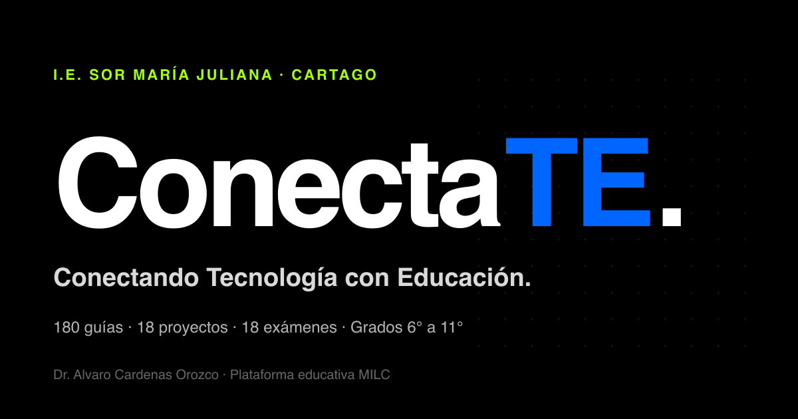
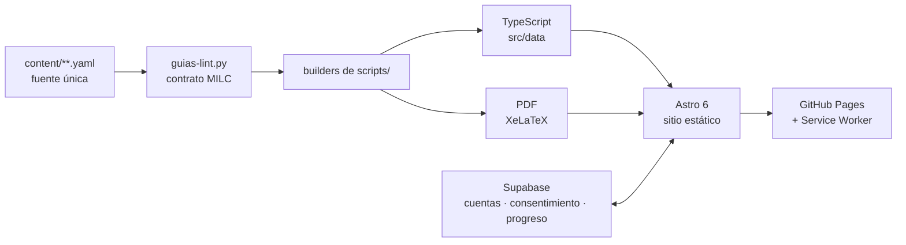

# 🎓 ConectaTE — Plataforma Educativa

[](https://alguarito.github.io/plataformaconectate/)
[](LICENSE)
[](https://astro.build)
[](https://supabase.com)
[](public/sw.js)



> **Conectando Tecnología con Educación**
> Plataforma educativa interactiva del área de Tecnología e Informática
> **Institución Educativa Sor María Juliana** · Cartago, Valle del Cauca
> Dr. Álvaro Cárdenas Orozco

🌐 **https://alguarito.github.io/plataformaconectate**

---

## 🇬🇧 In English

**ConectaTE** is an offline-first learning platform for Technology and Computing (grades 6–11) at a Colombian public school, built on the **MILC** pedagogical model (Modelo de Investigación Liberadora y Científica).

- **Curriculum as code.** Every guide, exam and project is a YAML file. Python builders turn each one into a print-ready PDF (XeLaTeX) and into the web version (TypeScript + Astro). A linter checks the editorial contract of every guide.
- **Built for low connectivity.** Most students use mid-range Android phones with limited data, so a custom Service Worker caches PDFs and pages, and the interface is designed mobile-first at 360 px.
- **Accounts with guardian consent.** Supabase (Postgres with row-level security and 5 Edge Functions) handles sign-up with guardian consent, student progress and teacher reports. A monthly GitHub Action sends progress reports to guardians.
- **Content.** 180 learning guides (30 per grade), 18 exams, 18 integrative projects, 10 Bebras-style computational thinking challenges, a research club track and a social-emotional program.
- **Stack.** Astro 6, Tailwind CSS, TypeScript, Supabase, Python, XeLaTeX, GitHub Actions and GitHub Pages.

Author: **Álvaro Cárdenas Orozco**, systems engineer and PhD in Education Sciences ([website](https://alvarocardenasorozco.com) · [ORCID](https://orcid.org/0000-0003-1820-301X)).

---

## 🎯 Objetivo

Plataforma web que organiza y comparte el material del área de Tecnología e Informática de los grados **6.º a 11.º**, estructurado en 3 períodos académicos por grado, bajo el modelo pedagógico **MILC**.

| Material | Cantidad | Fuente |
|---|---|---|
| 📘 Guías de aprendizaje | **180** (30 por grado) | `content/guias/{6..11}/` |
| 📝 Exámenes | **18** (uno por grado y período) | `content/examenes/` |
| 🛠 Proyectos integradores | **18** | `content/proyectos/` |
| 🦫 Retos Bebras | **10** | `content/guias/bebras/` |
| 🔬 Guías del Semillero | **12** de 20 | `content/guias/semillero/` |
| 🧠 Territorio Interior | **56** de 60 | `content/guias/territorio-interior/` |

Inspirada en [Física Interactiva](https://iemauxicartago.edu.co/Fisica/) de la I.E. María Auxiliadora de Cartago.

### Apartados propios

- 🔬 **`/semillero`** — Semillero de Investigación: 5 líneas STEM × 4 módulos anclados a las fases MILC.
- 🧠 **`/explora/territorio-interior`** — programa de educación socioemocional 6.º–11.º (60 momentos, cada uno con su ancla ancestral documentada).
- 🌌 **`/explora`** — hub de programas: Salomé (RECA), NASA-IASC, Bebras, Samsung Solve for Tomorrow.
- 🧬 **`/modelo-milc`** · 📋 **`/plan-de-area`** — el marco pedagógico y el plan del área.
- 👤 **`/cuenta`** · 👩‍🏫 **`/docente`** — registro con consentimiento del acudiente, progreso e informes.

---

## ⚙️ Stack Tecnológico

| Capa | Tecnología |
|------|-----------|
| Framework | [Astro 6](https://astro.build) (estático) |
| Estilos | [Tailwind CSS 3](https://tailwindcss.com) + sistema propio **Bento Moderna** |
| Tipografía | Inter (familia única) |
| Contenido | **YAML** como fuente única → PDF (XeLaTeX) + TypeScript (web) |
| Backend | [Supabase](https://supabase.com) — Postgres + RLS + Edge Functions |
| Offline | Service Worker propio (`public/sw.js`) |
| Hosting | GitHub Pages |
| CI/CD | GitHub Actions (Node 22) |

### Flujo del contenido



---

## 🚀 Instalación Local

### 1. Requisitos previos

- **Node.js ≥ 22.12** (lo exige Astro 6)
- **Python 3** con `pyyaml` — para los builders de contenido
- **XeLaTeX** (MacTeX o TeX Live) — solo si vas a compilar PDFs

### 2. Instalar dependencias

```bash
npm ci
```

### 3. Ejecutar en modo desarrollo

```bash
npm run dev
```

### 4. Construir para producción

```bash
npm run build
```

### 5. Previsualizar el build

```bash
npm run preview
```

> Para que `/cuenta` y `/docente` funcionen en local, copia `.env.example` a `.env.local` y rellena las claves de Supabase.

---

## 📁 Estructura del Proyecto

```
plataformaconectate/
├── .github/workflows/     # deploy.yml · security.yml · monthly-report.yml
├── content/               # ⭐ FUENTE ÚNICA del contenido (YAML)
│   ├── guias/{6..11}/     #   180 guías de grado
│   ├── guias/semillero/   #   guías del Semillero
│   ├── guias/bebras/      #   retos Bebras
│   ├── guias/territorio-interior/
│   ├── examenes/          #   18 exámenes  · _SCHEMA.md
│   ├── proyectos/         #   18 proyectos · _SCHEMA.md
│   └── plan-area/
├── scripts/               # Builders Python: YAML → PDF + TS
│   ├── build-guias-g11.py            # motor de guías de grado
│   ├── build-guias-semillero.py      # motor del Semillero
│   ├── build-guias-territorio-interior.py
│   ├── build-examenes.py · build-proyectos.py · build-plan-area.py
│   ├── guias-lint.py · guias-status.py
│   └── generadores/       #   plantillas LaTeX MILC v3 y generadores de recursos
├── public/
│   ├── guias-mejoras/     #   PDFs compilados + assets (TikZ, imágenes)
│   └── sw.js              #   Service Worker (¡ver regla de bump!)
├── src/
│   ├── components/        # GradoCard, PeriodoCard, LabQuiz, VisorPdf…
│   ├── data/              # grados.ts, semillero.ts, territorioInterior.ts, planArea.ts…
│   ├── layouts/           # BaseLayout.astro · GuiaLayout.astro
│   └── pages/             # index · grado-[numero] · semillero · explora · cuenta · docente
├── db/                    # schema.sql · policies.sql · migrations/
├── supabase/              # config.toml · migrations/ · functions/ (5 edge functions)
├── Makefile               # `make help` lista todo el pipeline
└── CLAUDE.md              # contrato de diseño y contrato editorial de las guías
```

---

## ✍️ Cómo agregar una nueva guía

El **YAML es la fuente única**: de él salen el PDF y la versión web. No se edita el LaTeX ni el TypeScript a mano.

```bash
# 1. Crear o editar el YAML (esquema en content/guias/_SCHEMA.md)
$EDITOR content/guias/11/11-2-3.yaml

# 2. Validar el contrato MILC v3 (200 palabras, verbos cognitivos, triángulo…)
make guia-lint

# 3. Compilar PDF + TS de esa guía
make guia-build CLAVE=2-3 GRADO=11

# 4. Ver el resultado
make guia-show CLAVE=2-3 GRADO=11
```

`make help` lista el pipeline completo: exámenes (`examen-build`), proyectos (`proyecto-build`), plan de área (`plan-area-build`), estado (`guia-status`) y assets (`guia-assets`).

---

## 🌐 Deploy a GitHub Pages

Cada `push` a `main` dispara `deploy.yml`, que compila en la nube (Node 22 → `npm ci` → `npm run build`) y publica en Pages. **No se suben `node_modules/` ni `dist/`.**

> [!warning] Regla del Service Worker
> Los PDFs se sirven **cache-first**. Si un push **regenera PDFs o imágenes de `public/`**, hay que subir la versión del Service Worker o los estudiantes seguirán viendo la copia vieja:
> ```bash
> make sw-bump
> ```
> La tabla completa de cuándo sí y cuándo no bumpear está en el encabezado de `public/sw.js`.

---

## 🎨 Sistema visual — Bento Moderna

Definido en [`tailwind.config.mjs`](tailwind.config.mjs). **No se reinventa: se ajusta dentro del sistema.**

| Token | Valor | Uso |
|-------|-------|-----|
| `bento.blue` | `#0066FF` | Primario |
| `bento.lime` · `bento.yellow` | — | Solo decorativos (no cumplen contraste sobre blanco) |
| `bento.orange` · `bento.pink` · `bento.purple` · `bento.cyan` | — | Acentos por sección y por línea |
| Radios | `bento-sm` 16px · `bento` 24px · `bento-lg` 32px | Tarjetas y contenedores |
| Sombras | `shadow-bento` · `shadow-bento-hover` | Elevación suave |

Accesibilidad no negociable: contraste **WCAG AA 4.5:1**, targets táctiles ≥ 44×44 px, `prefers-reduced-motion` respetado y modo oscuro (`darkMode: 'class'`) verificado en cada componente. Diseño **mobile-first**: se prueba a 360 px antes que a 1440 px.

---

## 📋 Estado

### ✅ Construido
- [x] 180 guías, 18 exámenes y 18 proyectos, con PDF y versión web desde un solo YAML
- [x] Pipeline de contenido con linter del contrato MILC v3 (`make guia-lint`)
- [x] Rediseño impreso MILC en las cuatro familias de documentos
- [x] Semillero de Investigación: 3 de 5 líneas completas (Astronomía, Pensamiento computacional y Robótica, 4 módulos cada una)
- [x] Territorio Interior: 56 de 60 momentos escritos, cada uno con su ancla documentada
- [x] Offline-first con Service Worker
- [x] Cuentas, consentimiento del acudiente, progreso e informes sobre Supabase
- [x] Censo de conectividad post-sismo (`/conectividad`)

### 🚧 En curso
- [ ] Migración de las guías de grado al contrato v3.1
- [ ] Territorio Interior: 3 momentos de sexto esperan su ancla, que se cierra con trabajo de campo y no con búsqueda (el momento 7 de séptimo se descartó por decisión ética)
- [ ] Semillero: líneas de IA e Innovación social

---

## 👤 Autor

**Dr. Álvaro Cárdenas Orozco**
Ingeniero de Sistemas y Computación, Doctor en Ciencias de la Educación · Docente de Tecnología e Informática
I.E. Sor María Juliana — Cartago, Valle del Cauca, Colombia

🌐 [alvarocardenasorozco.com](https://alvarocardenasorozco.com) · 🆔 [ORCID 0000-0003-1820-301X](https://orcid.org/0000-0003-1820-301X)

---

## 📑 Cómo citar

El repositorio trae [`CITATION.cff`](CITATION.cff); GitHub lo muestra en el botón **Cite this repository**. En APA 7.ª:

> Cárdenas Orozco, Á. (2026). *ConectaTE: plataforma educativa de Tecnología e Informática (6.º a 11.º)* [Software]. GitHub. https://github.com/alguarito/plataformaconectate

Para citar el modelo pedagógico, usa el artículo arbitrado y los libros de la Colección MILC por su DOI de concepto: están en [`/modelo-milc`](https://alguarito.github.io/plataformaconectate/modelo-milc/).

---

## 📜 Licencia

Creative Commons **CC BY-NC-SA 4.0** (uso educativo, no comercial, compartir igual) para el código y el contenido propio. Los libros de la Colección MILC, los retos tomados de Bebras y los recursos de terceros conservan su propia licencia. El detalle está en [`LICENSE`](LICENSE).

© 2026 Álvaro Cárdenas Orozco · ConectaTE.
